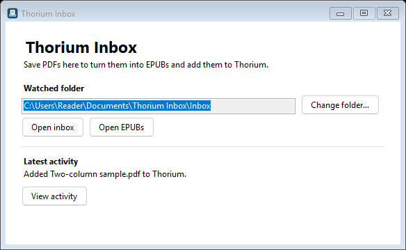

# Thorium Inbox

Thorium Inbox is a Windows tray app for people who want to send selected PDFs and EPUBs to [Thorium Reader](https://www.thoriumreader.com/). Put a PDF from any website or source into your inbox. The app waits for the file to finish downloading, converts it locally, and adds the EPUB to Thorium.

## Install

Signed installers for Windows x64 are published on [GitHub Releases](../../releases). Setup checks for Thorium Reader and installs the official EDRLab build if needed. It also lets you choose the watched folder and registers Thorium Inbox to start at Windows sign-in. See [building from source](CONTRIBUTING.md#build-the-desktop-app) for a local development build.

## Use

1. Open **Thorium Inbox** from Start or the notification area and select **Open inbox**. The default is `Documents\Thorium Inbox\Inbox`.
2. Save, copy, or move the PDFs and EPUBs you want to read into that folder. Existing EPUBs go straight to Thorium. Your original PDFs stay in the inbox.
3. Use **Open EPUBs** to find your converted copies in `Documents\Thorium Inbox\EPUBs`. Use **View activity** to see a failed import or check what was added.

The EPUB format preserves page layout as images. It works for magazine columns, scans, and other fixed pages, with zoom in Thorium. Keep the original PDF if you need to search or select its text.

## Develop

Contributors work on a fork and open pull requests against `develop`. The complete released source lives on `main`. See the [contribution guide](CONTRIBUTING.md), [issue forms](../../issues/new/choose), and [release instructions](docs/releasing.md). VPS-hosted app updates are on the [roadmap](docs/roadmap.md).

Thorium Inbox is open source under the [GNU General Public License version 3](LICENSE) (GPL-3.0-only). [Third-party notices](THIRD-PARTY-NOTICES.md) cover the bundled libraries. Thorium Reader is developed by EDRLab.
